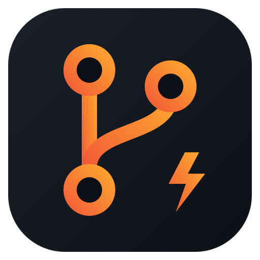
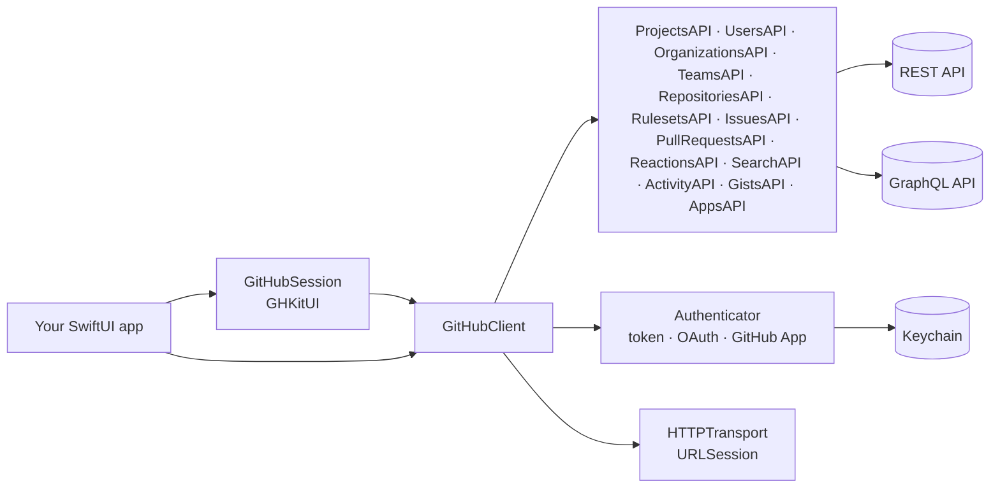

<div align="center">
  

  <h1>GHKit</h1>

  [](https://swift.org)
  [](#-requirements)
  [](#-installation)
  [](TODO.md)
  [](TODO.md#milestones)
  [](LICENSE)
  [](https://emmanuel-defreitas.github.io/GHKit/documentation/)

  **🐙⚡ The GitHub API for SwiftUI apps: async/await, typed throws, and sign-in that just works.**

  [Quick start](#-quick-start) · [Authentication](#-authentication) · [Projects](#-projects) · [SwiftUI](#-swiftui) · [Documentation](https://emmanuel-defreitas.github.io/GHKit/documentation/) · [Roadmap](TODO.md)
</div>

---

```swift
let github = GitHubClient(token: "github_pat_…")

for try await project in github.projects(.organization("acme")).list(matching: "is:open") {
    print(project.number, project.title)
}
```

No completion handlers, no `Result` juggling, no hand-rolled pagination. Iterate, and pages load as you go.

## ✨ Why GHKit

- ⚡ **Swift concurrency all the way down.** Every call is `async`. Decoding runs off the main actor, so big payloads don't stall your UI.
- 🎯 **Errors you can switch on.** Every API uses `throws(GitHubError)`, so `catch .notFound` and `catch .rateLimited` just work.
- 🔐 **Every way to sign in.** Personal tokens, OAuth device flow, OAuth web flow with PKCE, GitHub App JWTs, and installation tokens. Expiring tokens refresh on their own.
- 📱 **SwiftUI-ready.** An `@Observable` session that keeps the token in the Keychain, a drop-in sign-in screen, and a `\.gitHubClient` environment value.
- 🔁 **Pagination as an `AsyncSequence`.** Works for page-number and cursor endpoints alike. Breaking out of the loop stops loading.
- 🛡️ **Polite by default.** Secondary rate limits and transient server errors are retried. A `401` triggers one credential refresh and a retry.
- 🏢 **Enterprise-ready.** Point it at GitHub Enterprise Server or GHE.com with one setting.
- 🧩 **Never blocked.** Call any REST endpoint or GraphQL query GHKit doesn't wrap yet, with the same auth, retries, and errors.

## 📋 Table of contents

- [Requirements](#-requirements)
- [Installation](#-installation)
- [Documentation](#-documentation)
- [Quick start](#-quick-start)
- [Authentication](#-authentication)
- [SwiftUI](#-swiftui)
- [Projects](#-projects)
- [Errors](#-errors)
- [Pagination](#-pagination)
- [Beyond the wrapped API](#-beyond-the-wrapped-api)
- [AI assistants (MCP)](#-ai-assistants-mcp)
- [GitHub Enterprise](#-github-enterprise)
- [How it fits together](#-how-it-fits-together)
- [Roadmap](#-roadmap)
- [Contributing](#-contributing)
- [License](#-license)

## ✅ Requirements

| | Minimum |
|---|---|
| Swift | 6.2 (Xcode 26) |
| iOS / iPadOS | 17 |
| macOS | 14 |
| tvOS | 17 |
| watchOS | 10 |
| visionOS | 1 |

## 📦 Installation

In Xcode, choose **File → Add Package Dependencies…** and enter the repository URL. Or add it to `Package.swift`:

```swift
dependencies: [
    .package(url: "https://github.com/emmanuel-defreitas/GHKit.git", from: "0.1.0"),
],
targets: [
    .target(name: "MyApp", dependencies: [
        .product(name: "GHKit", package: "GHKit"),     // every domain; or pick some, such as "GHKitIssues"
        .product(name: "GHKitUI", package: "GHKit"),   // optional SwiftUI helpers
        .product(name: "GHKitMCP", package: "GHKit"),  // optional MCP tools for AI assistants
    ]),
]
```

| Product | What's in it |
|---|---|
| `GHKit` | Every domain below, in one import. No UI. |
| `GHKitCore` | The client, authentication, pagination, GraphQL, custom requests, and the models the domains share. |
| `GHKitUsers` | `github.users`: profiles, emails, keys, followers. |
| `GHKitRepositories` | `github.repositories` and `github.rulesets`: contents, branches, commits, releases, deployments, Pages, webhooks. |
| `GHKitIssues` | `github.issues` and `github.reactions`: comments, labels, milestones, timelines, sub-issues. |
| `GHKitPullRequests` | `github.pullRequests`: reviews, review comments, merging. |
| `GHKitOrganizations` | `github.organizations` and `github.teams`. |
| `GHKitProjects` | `github.projects(_:)`: fields, items, views, status updates. |
| `GHKitActivity` | `github.activity`: notifications, events, stars, watching. |
| `GHKitGists` | `github.gists`. |
| `GHKitSearch` | `github.search`. |
| `GHKitApps` | `github.apps`: GitHub App and OAuth app management. |
| `GHKitUI` | `GitHubSession`, `GitHubSignInView`, `DeviceCodeView`, and the `\.gitHubClient` environment value. |
| `GHKitMCP` | `GitHubToolbox`: GitHub tools for a Model Context Protocol server. Adds the [MCP Swift SDK](https://github.com/modelcontextprotocol/swift-sdk). |

Each domain module brings `GHKitCore` with it, so `import GHKitIssues` is enough to make a client and list issues.
Use `GHKit` while exploring, then switch to the domains you use to keep builds and autocomplete small.

## 📚 Documentation

The full API reference and guides are at **[emmanuel-defreitas.github.io/GHKit](https://emmanuel-defreitas.github.io/GHKit/documentation/)**,
built with DocC and published on every release.

## 🚀 Quick start

```swift
import GHKit

let github = GitHubClient(token: "github_pat_…")

let status = try await github.verifyAuthentication()
print("Signed in as \(status.user.login) with scopes \(status.scopes ?? [])")

let limits = try await github.rateLimit()
print("\(limits.core?.remaining ?? 0) requests left this hour")
```

## 🔐 Authentication

| Credential | Best for | GHKit type |
|---|---|---|
| Personal access token | Scripts and personal tools | `GitHubClient(token:)` |
| OAuth device flow | **Native apps (recommended).** No secret, no redirect URL. | `DeviceFlow` |
| OAuth web flow + PKCE | Apps with a backend for the code exchange | `OAuthWebFlow` |
| GitHub App JWT | `/app` endpoints, on a server | `GitHubAppAuthenticator` |
| GitHub App installation | Acting as an installation, on a server | `InstallationAuthenticator` |

### Device flow

Turn on device flow in your OAuth app or GitHub App settings, then:

```swift
let flow = DeviceFlow(clientID: "Iv1.abc123", scopes: [.repo, .project])

let authorization = try await flow.start()
// Show authorization.userCode and open authorization.verificationURL

let credential = try await flow.waitForAuthorization(authorization)

let github = GitHubClient(authenticator: OAuthAuthenticator(
    credential: credential,
    refresh: .init(clientID: "Iv1.abc123"),
    store: KeychainCredentialStore(service: "com.example.app")
))
```

Polling follows GitHub's interval and `slow_down` replies. Cancel the task to stop waiting.

### Web flow

```swift
let flow = OAuthWebFlow(clientID: "abc", clientSecret: nil, redirectURI: URL(string: "myapp://oauth")!)
let request = flow.makeAuthorizationRequest()        // random state + PKCE challenge
// Open request.url, then on callback:
let credential = try await flow.exchange(callbackURL: callbackURL, for: request)
```

> [!IMPORTANT]
> GitHub still requires the client secret for the code exchange. Don't ship it in your app. Exchange the code on your server with `exchange(code:codeVerifier:)`, or use device flow.

### GitHub App installation (server side)

```swift
let app = try GitHubAppCredentials(issuer: "Iv23li…", privateKeyPEM: pem)
let github = GitHubClient(authenticator: InstallationAuthenticator(app: app, installationID: 42))
```

Installation tokens are minted on first use, cached, and renewed before they expire. Concurrent requests share one token fetch.

## 📱 SwiftUI

```swift
import SwiftUI
import GHKit
import GHKitUI

@main
struct MyApp: App {
    @State private var session = GitHubSession(clientID: "Iv1.abc123", scopes: [.repo, .readOrg, .project])

    var body: some Scene {
        WindowGroup {
            Group {
                if session.isSignedIn {
                    ProjectsView()
                } else {
                    GitHubSignInView(session: session)
                }
            }
            .environment(session)
            .gitHubClient(session.client)
            .task { await session.restore() }
        }
    }
}

struct ProjectsView: View {
    @Environment(\.gitHubClient) private var github
    @State private var projects: [Project] = []

    var body: some View {
        List(projects) { Text($0.title) }
            .task {
                guard let github else { return }
                projects = (try? await github.projects(.organization("acme")).list().collect()) ?? []
            }
    }
}
```

`GitHubSession` saves the token in the Keychain, restores it at launch, refreshes it when it expires, and publishes the latest `rateLimit` for your UI.

## 🗂️ Projects

Projects belong to an organization or a user. Get an API for one owner, then work with project numbers:

```swift
let acme = github.projects(.organization("acme"))   // or .user("octocat")
```

**Read**

```swift
let roadmap = try await acme.project(1)
let status = try await acme.field(named: "Status", of: 1)

for try await item in acme.items(of: 1, matching: "is:open assignee:@me", fields: [status.id]) {
    print(item.title ?? "", item.value(forField: status.id)?.singleSelectOptionName ?? "—")
}
```

**Change items**

```swift
let item = try await acme.addItem(.issue(owner: "acme", repository: "app", number: 12), to: 1)

try await acme.updateItem(item.id, in: 1, [
    .set(status, to: .singleSelect(optionID: status.option(named: "In progress")!.id)),
])

let draft = try await acme.addDraftIssue(title: "Spike: offline mode", to: 1)
```

**Manage projects**

```swift
let sprint = try await acme.create(title: "Sprint 42")
try await acme.update(sprint.number, shortDescription: "Two weeks of polish")
try await acme.createStatusUpdate(in: sprint.number, status: .onTrack, body: "Shipping Friday")
try await acme.close(sprint.number)
```

Creating, editing, closing, copying, linking, status updates, and item archiving only exist in GitHub's GraphQL API. GHKit handles that for you and still returns the same `Project` and `ProjectItem` types.

<details>
<summary><b>Everything ProjectsAPI can do</b></summary>

| Area | Methods |
|---|---|
| Projects | `list`, `project`, `create`, `update`, `close`, `reopen`, `delete`, `copy`, `markAsTemplate`, `unmarkAsTemplate` |
| Fields | `fields`, `field`, `field(named:)`, `addField`, `updateField`, `deleteField` |
| Items | `items`, `item`, `addItem`, `addDraftIssue`, `updateItem`, `deleteItem`, `archive`, `unarchive`, `move`, `convertDraftToIssue`, `updateDraftIssue` |
| Views | `createView`, `items(inView:)` |
| Status updates | `statusUpdates`, `createStatusUpdate`, `updateStatusUpdate`, `deleteStatusUpdate` |
| Access | `link(toRepository:)`, `link(toTeam:)`, `unlink`, `updateCollaborators` |

</details>

## 🧯 Errors

```swift
do {
    let project = try await acme.project(99)
} catch .notFound {
    // Missing, or this token can't see it
} catch .rateLimited(let limit, let retryAfter, _, _) {
    // limit?.reset says when to try again
} catch .unauthorized {
    await session.signOut()
} catch {
    print(error.localizedDescription)
}
```

Change retry behavior with `GitHubConfiguration(retryPolicy:)`, or turn it off with `.none`.

## 🔁 Pagination

```swift
// Lazy: pages load as you iterate
for try await item in acme.items(of: 1) { … }

// Everything, or just the first N
let first100 = try await acme.items(of: 1).collect(limit: 100)

// "Load more" buttons
let request = acme.itemsRequest(of: 1)
var page = try await github.page(request)
if let next = page.next {
    page = try await github.page(request, at: next)
}
```

## 🧩 Beyond the wrapped API

Any REST endpoint, with the same auth, retries, and errors:

```swift
struct Label: Decodable, Sendable { let name: String; let color: String }

let labels = try await github
    .paginate(GitHubRequest<[Label]>(.get, "/repos/acme/app/labels"))
    .collect()
```

Any GraphQL query:

```swift
struct Viewer: Decodable, Sendable {
    struct User: Decodable, Sendable { let login: String }
    let viewer: User
}

let viewer = try await github.graphQL("query { viewer { login } }", as: Viewer.self)
```

## 🤖 AI assistants (MCP)

Let Claude and other AI assistants use GitHub through your app, as the signed-in user:

```swift
import GHKitMCP
import MCP

let toolbox = GitHubToolbox(client: github, toolsets: [.context, .repositories])  // read-only by default
let server = await toolbox.makeServer(name: "MyApp", version: "1.0")
try await server.start(transport: StdioTransport())
```

Pick toolsets, pass `access: .readWrite` to allow changes, or follow a `GitHubSession` with
`GitHubToolbox { await session.client }`. Try it with `GITHUB_TOKEN=… npx @modelcontextprotocol/inspector swift run ghkit-mcp`.

## 🏢 GitHub Enterprise

```swift
let config = GitHubConfiguration(server: .enterpriseServer(URL(string: "https://github.example.com")!))
// or .enterpriseCloud(subdomain: "acme") for acme.ghe.com

let github = GitHubClient(token: token, configuration: config)
```

## 🏗️ How it fits together



Swap the `HTTPTransport` to add logging or caching, or to stub responses in tests.

## 🗺️ Roadmap

GHKit is growing in milestones. [TODO.md](TODO.md) tracks every one of GitHub's 1,254 REST endpoints (580 done, 46%), plus the GraphQL-only features.

| Milestone | Scope | Status |
|---|---|---|
| M1 | Authentication & Projects | ✅ Done |
| M2 | Users, organizations, teams, repositories | 🚧 In progress |
| M3 | Issues, pull requests, search, activity | ✅ Done |
| M4 | Actions, checks, packages, app webhooks | Planned |
| M5 | Code scanning, secret scanning, Dependabot | Planned |
| M6 | Copilot, Codespaces, billing, migrations | Planned |

## 🤝 Contributing

Contributions are welcome. See [CONTRIBUTING.md](CONTRIBUTING.md) for how to pick an endpoint, the coding conventions, and the pull request checklist.

```sh
swift build
swift test
```

Tests run against GitHub's own example payloads (in `Tests/GHKitTests/Fixtures`) through a mock transport, so they don't need network access or a token.

When you add endpoints, mark them done in `Scripts/generate_todo.py` and regenerate the tracker:

```sh
curl -sSL -o /tmp/api.json \
  https://raw.githubusercontent.com/github/rest-api-description/main/descriptions/api.github.com/api.github.com.json
python3 Scripts/generate_todo.py /tmp/api.json > TODO.md
```

⭐ If GHKit saved you from writing another pagination loop, a star would make our day.

## 📄 License

GHKit is available under the [MIT License](LICENSE).
